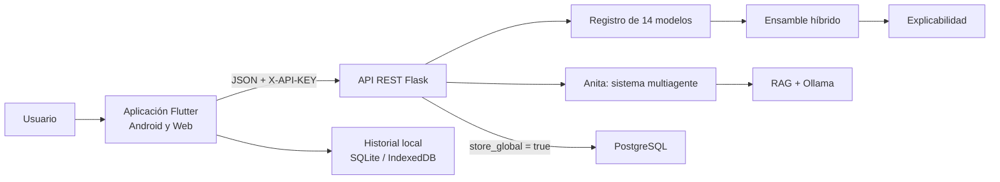

<div align="center">
  
  <h1>LinkShield AI</h1>
  <p><strong>Plataforma inteligente, explicable y multiplataforma para analizar URLs y detectar phishing.</strong></p>
  <p>
    
    
    
    
    
  </p>
  <p>Desarrollado por <strong>Alejandro Mayró Lena</strong></p>
  <p><a href="https://github.com/users/AlejandroDart/projects/1"><strong>Planificación y seguimiento</strong></a> | <a href="https://github.com/users/AlejandroDart/projects/1/views/5"><strong>Cronograma Gantt</strong></a></p>
</div>

---

## Descripción

LinkShield AI es una solución académica de ciberseguridad que analiza una URL, estima su probabilidad de phishing y explica las señales que influyeron en el resultado. La plataforma combina modelos de machine learning, deep learning tabular, redes secuenciales de caracteres y reglas heurísticas en un ensamble híbrido calibrado.

El sistema está organizado como una arquitectura cliente-servidor: una aplicación Flutter consume una API REST desarrollada con Flask, mientras que los artefactos de inteligencia artificial se mantienen en un módulo independiente y reproducible mediante notebooks.

## Capacidades principales

- Análisis manual de URLs y captura visual mediante OCR.
- Catálogo seleccionable de 14 modelos de clasificación.
- Modelo recomendado `LinkShield Hybrid Ensemble` con F1-score de **95.00 %**.
- Explicabilidad adaptada a cada familia: SHAP, permutación, oclusión de caracteres y reglas auditables.
- Perfiles de sensibilidad agresivo, equilibrado y pasivo sin alterar la probabilidad del modelo.
- Historial local con SQLite en Android e IndexedDB en navegador.
- Almacenamiento global opcional y condicionado por consentimiento.
- Dashboard, métricas, matriz de confusión e información del modelo activo.
- Asistente Anita con arquitectura multiagente, RAG y soporte local mediante Ollama.
- Interfaz adaptable con temas claro y oscuro.

## Arquitectura



## Estructura del repositorio

| Módulo | Responsabilidad | Documentación |
|---|---|---|
| `phishing-url-ai` | Datos, entrenamiento, evaluación y exportación de modelos | [Modelos de IA](phishing-url-ai/README.md) |
| `phishing-url-api` | Inferencia, explicabilidad, persistencia y sistema multiagente | [API REST](phishing-url-api/README.md) |
| `phishing-url-app` | Aplicación Flutter para Android y navegador | [Aplicación](phishing-url-app/README.md) |

## Modelo recomendado

El modelo predeterminado es **LinkShield Hybrid Ensemble**. Integra cinco ramas y utiliza una regresión logística como meta-clasificador:

1. Random Forest sobre 25 características.
2. MLP regularizada sobre la entrada tabular.
3. CNN 1D sobre caracteres de la URL.
4. GRU sobre secuencias de caracteres.
5. Motor heurístico con reglas auditables.

| Métrica | Resultado |
|---|---:|
| Accuracy | 95.01 % |
| Precision | 95.25 % |
| Recall | 94.75 % |
| F1-score | 95.00 % |
| ROC-AUC | 0.9877 |

La matriz de confusión sobre 2,286 observaciones contiene 1,089 verdaderos negativos, 1,083 verdaderos positivos, 54 falsos positivos y 60 falsos negativos.

## Inicio rápido

### Requisitos

- Python 3.12.
- Flutter SDK compatible con Dart `^3.5.3`.
- PostgreSQL para persistencia global opcional.
- Ollama para respuestas generativas locales opcionales.

### 1. API

```powershell
cd C:\phishing-url-classifier\phishing-url-api
py -3.12 -m venv .venv
.\.venv\Scripts\Activate.ps1
python -m pip install -r requirements.txt
python app.py
```

La API queda disponible por defecto en `http://127.0.0.1:5000`.

### 2. Aplicación Flutter

```powershell
cd C:\phishing-url-classifier\phishing-url-app
flutter pub get
flutter run -d chrome `
  --dart-define=API_BASE_URL=http://127.0.0.1:5000 `
  --dart-define=API_KEY=REEMPLAZAR_CON_UNA_CLAVE_LOCAL
```

Para exponer la versión web en la red local:

```powershell
flutter run -d web-server --release `
  --web-hostname=0.0.0.0 --web-port=8005 `
  --dart-define=API_BASE_URL=http://IP_DEL_EQUIPO:5000 `
  --dart-define=API_KEY=REEMPLAZAR_CON_UNA_CLAVE_LOCAL
```

Consulta las instrucciones completas en los README de cada módulo.

## Pruebas

```powershell
# Backend
cd phishing-url-api
python -m pytest -q

# Aplicación
cd ..\phishing-url-app
flutter analyze
flutter test
```

La validación más reciente del proyecto registró **79 pruebas backend** y **15 pruebas Flutter** aprobadas.

## Privacidad y seguridad

- `store_global=false` evita registrar análisis y conversaciones en el servidor.
- El historial local se conserva en el dispositivo o navegador del usuario.
- No publiques archivos `.env`, contraseñas, claves de API ni registros con datos sensibles.
- Una clave compilada en una aplicación web puede ser inspeccionada. En producción se requiere autenticación de usuarios, un proxy de backend y HTTPS.
- La clasificación es un apoyo preventivo: no reemplaza una revisión profesional ni demuestra por sí sola que un sitio sea malicioso.

## Estado del proyecto

Proyecto académico y experimental en desarrollo. La arquitectura, los modelos y las métricas están documentados para facilitar su reproducción, evaluación y evolución.

## Planificación y seguimiento

La continuidad de **LinkShield AI** se gestiona en GitHub Projects, donde se organizan las actividades, los hitos técnicos y académicos, las fechas y los estados de avance.

**[Ver el cronograma general (Gantt)](https://github.com/users/AlejandroDart/projects/1/views/5)**

El tablero permite revisar:

- **[Hitos del proyecto](https://github.com/users/AlejandroDart/projects/1/views/1):** resultados técnicos y compromisos de entrega.
- **[Tablero de actividades](https://github.com/users/AlejandroDart/projects/1/views/2):** implementación, integración, pruebas, seguridad y documentación, organizadas por estado.
- **[Cronograma de tareas](https://github.com/users/AlejandroDart/projects/1/views/3):** fechas de inicio y objetivo de las actividades.
- **[Entregas académicas](https://github.com/users/AlejandroDart/projects/1/views/4):** las cuatro entregas principales del proyecto.
- **[Cronograma general (Gantt)](https://github.com/users/AlejandroDart/projects/1/views/5):** hitos y actividades en una línea de tiempo para visualizar la secuencia de trabajo.

### Entregas principales de 2026

| Fecha | Hito | Entregable previsto |
|---|---|---|
| 27 de octubre | Primer informe y presentación, 70 % | MVP funcional, evidencia de pruebas y planificación actualizada. |
| 17 de noviembre | Segundo informe de avance, 90 % | Consolidación de la aplicación y resultados de rendimiento, seguridad y validación con usuarios. |
| 8 de diciembre | Entrega final, 100 % | Solución y documentación finales, con resultados y evidencias del alcance aprobado. |
| 29 de diciembre | Presentación ante comisión | Defensa del proyecto, demostración y respaldo de resultados. |

Estos porcentajes corresponden a los hitos de entrega. El avance de cada actividad se registra por separado en el tablero. La planificación conserva los hitos técnicos iniciales y continúa con la consolidación, validación y cierre del proyecto.

**Responsable de la planificación y el seguimiento:** Alejandro Mayró Lena.

## Autor

**Alejandro Mayró Lena**

Proyecto desarrollado como solución de análisis y prevención de phishing.

