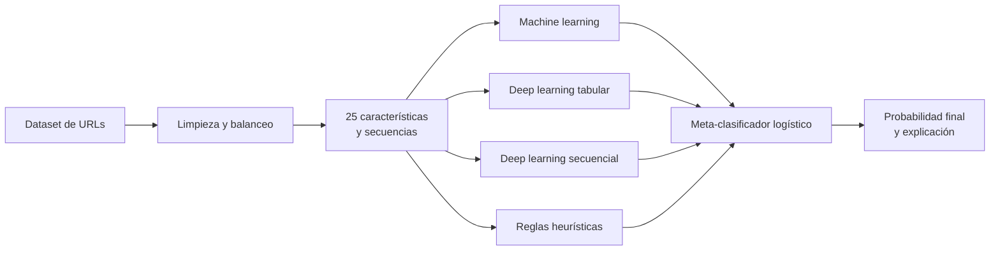

<div align="center">
  
  <h1>LinkShield AI · Modelos de inteligencia artificial</h1>
  <p><strong>Entrenamiento reproducible de modelos clásicos, redes neuronales, secuencias de caracteres y un ensamble híbrido explicable.</strong></p>
  <p>
    
    
    
    
  </p>
</div>

---

## Objetivo

Este módulo reúne el dataset, la preparación de características, los notebooks de experimentación y los artefactos exportados que utiliza la API. El objetivo es comparar distintas familias de clasificación de URLs y combinar evidencia complementaria en un modelo híbrido trazable.

## Flujo experimental



## Dataset

El ensamble utiliza `dataset-phishing-clean.csv`, con **11,429 observaciones**. La partición registrada para el modelo híbrido es:

| Conjunto | Filas | Uso |
|---|---:|---|
| Entrenamiento | 6,857 | Ajuste de las ramas |
| Validación | 1,143 | Selección y control de sobreajuste |
| Calibración | 1,143 | Entrenamiento del meta-clasificador |
| Prueba | 2,286 | Evaluación final independiente |

Las ramas tabulares procesan 25 características léxicas, estructurales, de dominio y contenido. Las ramas secuenciales reciben la URL normalizada como una secuencia de caracteres.

## Notebooks

| Archivo | Propósito |
|---|---|
| `01_eda_analisis_dataset_phishing.ipynb` | Análisis exploratorio del dataset |
| `02_limpieza_preparacion_dataset.ipynb` | Limpieza, balanceo y preparación |
| `03_seleccion_features.ipynb` | Selección de variables relevantes |
| `04_feature_engineering_normalizacion.ipynb` | Ingeniería y escalado de características |
| `05_modelos_machine_learning.ipynb` | Entrenamiento de modelos clásicos |
| `06_prediccion_url_top25_con_scaler.ipynb` | Predicción con las 25 variables |
| `07_prueba_extractor_modelo_scaler.ipynb` | Validación del extractor y scaler |
| `08_prediccion_manual_top25_con_scaler.ipynb` | Prueba manual del flujo tabular |
| `09_modelos_deep_learning_top25.ipynb` | MLP tabulares |
| `10_modelos_deep_learning_secuencial.ipynb` | CNN 1D, GRU y BiLSTM por caracteres |
| `11_modelo_hibrido_ml_dl_heuristicas.ipynb` | Calibración y exportación del ensamble híbrido |

## Catálogo de modelos

| Modelo | Familia | F1-score | Recomendado |
|---|---|---:|:---:|
| Regresión Logística | Machine learning | 91.51 % | No |
| Árbol de Decisión | Machine learning | 91.76 % | No |
| Random Forest Top 25 | Machine learning | 94.91 % | No |
| Gradient Boosting | Machine learning | 93.96 % | No |
| K-Nearest Neighbors | Machine learning | 93.62 % | No |
| Support Vector Machine | Machine learning | 93.77 % | No |
| MLP Regularizada | Deep learning tabular | 94.13 % | No |
| MLP Compacta | Deep learning tabular | 94.05 % | No |
| MLP Residual | Deep learning tabular | 93.47 % | No |
| CNN 1D por caracteres | Deep learning secuencial | 86.71 % | No |
| GRU por caracteres | Deep learning secuencial | 84.40 % | No |
| BiLSTM por caracteres | Deep learning secuencial | 83.33 % | No |
| Motor heurístico | Heurístico | 70.13 % | No |
| **LinkShield Hybrid Ensemble** | **Híbrido** | **95.00 %** | **Sí** |

## Ensamble híbrido

El modelo recomendado integra estas ramas:

- `random_forest`: 25 características tabulares.
- `mlp_regularized`: representación tabular escalada.
- `cnn_1d`: patrones locales de caracteres.
- `gru`: dependencias secuenciales de la URL.
- `heuristic`: reglas léxicas y estructurales auditables.

Las cinco probabilidades son entradas de un meta-clasificador logístico. La operación exportada es:

```text
z = -5.2777
    + 4.4901 p_RF
    + 2.2978 p_MLP
    + 2.0589 p_CNN
    + 1.3840 p_GRU
    + 0.4656 p_H

P(phishing) = 1 / (1 + exp(-z))
```

No se trata de un promedio simple: los coeficientes fueron aprendidos usando el conjunto de calibración.

## Resultados del modelo recomendado

| Métrica | Resultado |
|---|---:|
| Accuracy | 95.01 % |
| Precision | 95.25 % |
| Recall | 94.75 % |
| F1-score | 95.00 % |
| ROC-AUC | 0.9877 |

Matriz de confusión sobre 2,286 observaciones:

| Real / Predicha | Legítima | Phishing |
|---|---:|---:|
| Legítima | 1,089 VN | 54 FP |
| Phishing | 60 FN | 1,083 VP |

## Explicabilidad

La explicación cambia según la familia para conservar significado técnico:

| Familia | Estrategia |
|---|---|
| Árboles | SHAP para modelos arbóreos |
| Tabulares no arbóreos | Perturbación o permutación |
| Secuenciales | Oclusión de caracteres y fragmentos |
| Heurístico | Reglas activadas y evidencia observada |
| Híbrido | Contribución por rama más señales internas principales |

Cada factor puede incluir nombre técnico, etiqueta comprensible, valor observado, dirección y magnitud del impacto. Una contribución positiva aumenta el riesgo respecto de la base y una negativa lo reduce; ninguna señal aislada demuestra por sí sola que una URL sea maliciosa.

## Artefactos

```text
models/
├── ml/             # Modelos clásicos y registro
├── deep_learning/  # MLP tabulares y metadatos
├── sequential/     # CNN, GRU, BiLSTM y vocabulario
└── hybrid/         # Ramas, meta-clasificador y registro híbrido
```

El registro unificado que consume la API se genera a partir de estos manifiestos. No cambies el orden de las 25 variables sin volver a exportar los modelos y sus metadatos.

## Reproducción

1. Crea un entorno de Python 3.12.
2. Instala las dependencias definidas en `../phishing-url-api/requirements.txt`.
3. Ejecuta los notebooks en orden numérico.
4. Verifica que las particiones y semillas se conserven.
5. Sincroniza el registro unificado con el script correspondiente.
6. Ejecuta las pruebas de la API antes de sustituir artefactos en producción.

```powershell
cd C:\phishing-url-classifier\phishing-url-ai
python scripts\sync_unified_model_registry.py
```

Los archivos `.pkl` y `.keras` solo deben cargarse si provienen de una fuente confiable.

## Autor

**Alejandro Mayró Lena**

Consulta la [documentación general](../README.md), la [API REST](../phishing-url-api/README.md) y la [aplicación Flutter](../phishing-url-app/README.md).

