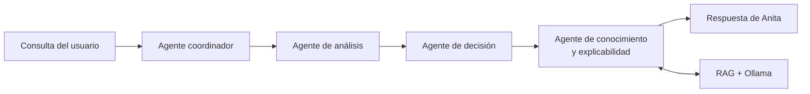

<div align="center">
  
  <h1>LinkShield AI · API REST</h1>
  <p><strong>Backend Flask para inferencia multimodelo, explicabilidad, persistencia y coordinación multiagente.</strong></p>
  <p>
    
    
    
    
  </p>
</div>

---

## Descripción

La API de LinkShield AI centraliza el acceso a los modelos, la extracción de 25 características, la predicción, la aplicación del umbral de sensibilidad y la generación de explicaciones. También ofrece estadísticas, persistencia global opcional y el asistente Anita mediante una arquitectura de cuatro agentes.

## Responsabilidades

- Validar solicitudes y autenticar rutas mediante `X-API-KEY`.
- Resolver dinámicamente uno de los 14 modelos registrados.
- Extraer señales léxicas, estructurales, de dominio y contenido.
- Calcular probabilidad, etiqueta y umbral efectivo.
- Producir explicabilidad adaptada a cada familia de modelos.
- Guardar predicciones solo cuando `store_global=true`.
- Exponer métricas, matriz de confusión y metadatos del modelo.
- Coordinar análisis conversacionales, conocimiento y explicación.

## Arquitectura interna

```text
phishing-url-api/
├── app.py          # Creación y configuración de Flask
├── routes/         # Predicción, chatbot, modelos y estadísticas
├── services/       # Inferencia, registro, SHAP, RAG y reglas
├── multiagent/     # Agentes, mensajes y orquestador
├── database/       # Conexión, repositorios y migraciones
├── models/         # Artefactos y registro unificado
├── chatbot/        # Base de conocimiento
├── scripts/        # Exportación y validaciones operativas
└── tests/          # Suite automatizada
```

## Sistema multiagente



El coordinador clasifica la intención y conserva el contexto. Según la consulta, el flujo puede ejecutar una predicción, explicar el último análisis, responder desde la base de conocimiento o cambiar preferencias operativas admitidas por la aplicación.

## Instalación

```powershell
cd C:\phishing-url-classifier\phishing-url-api
py -3.12 -m venv .venv
.\.venv\Scripts\Activate.ps1
python -m pip install --upgrade pip
python -m pip install -r requirements.txt
```

## Variables de entorno

Crea un archivo `.env` local que no debe publicarse:

```dotenv
API_KEY=REEMPLAZAR_CON_UNA_CLAVE_SEGURA

DB_HOST=localhost
DB_PORT=5432
DB_USER=postgres
DB_PASSWORD=REEMPLAZAR
DB_NAME=phishing_detector

MULTI_AGENT_CHAT_ENABLED=true
OLLAMA_BASE_URL=http://127.0.0.1:11434
OLLAMA_CHAT_MODEL=nombre_del_modelo_local
```

PostgreSQL es necesario para el historial global y la memoria persistente de agentes. La predicción puede operar sin almacenamiento global cuando la solicitud utiliza `store_global=false`.

## Base de datos

Las migraciones incrementales se encuentran en `database/migrations`:

```powershell
psql -U postgres -d phishing_detector -f database/migrations/001_multiagent_memory.sql
psql -U postgres -d phishing_detector -f database/migrations/002_prediction_model.sql
psql -U postgres -d phishing_detector -f database/migrations/003_prediction_sensitivity.sql
```

Las migraciones `002` y `003` asumen que la tabla base `predictions` ya existe.

## Ejecución

```powershell
python app.py
```

Verificación rápida:

```powershell
Invoke-RestMethod http://127.0.0.1:5000/
```

## Endpoints

| Método | Ruta | Función | API key |
|---|---|---|:---:|
| `GET` | `/` | Estado básico del servicio | No |
| `POST` | `/predict` | Clasificar y explicar una URL | Sí |
| `POST` | `/explain-features` | Reconstruir explicación desde características | Sí |
| `GET` | `/models` | Consultar el catálogo de modelos | Sí |
| `GET` | `/model/info` | Obtener métricas y metadatos | Sí |
| `POST` | `/chat` | Consultar a Anita | Sí |
| `GET` | `/chat/health` | Estado del subsistema conversacional | Sí |
| `GET` | `/stats/count` | Total de análisis globales | Según despliegue |
| `GET` | `/stats/phishing-ratio` | Proporción de phishing | Según despliegue |
| `GET` | `/stats/recent` | Actividad reciente | Según despliegue |
| `GET` | `/stats/daily` | Serie diaria | Según despliegue |

## Ejemplo de predicción

```powershell
$headers = @{ 'X-API-KEY' = 'CLAVE_LOCAL' }
$body = @{
  url = 'https://ejemplo.com/acceso'
  model_id = 'hybrid_ensemble'
  sensitivity_profile = 'balanced'
  store_global = $false
} | ConvertTo-Json

Invoke-RestMethod `
  -Method Post `
  -Uri http://127.0.0.1:5000/predict `
  -Headers $headers `
  -ContentType 'application/json' `
  -Body $body
```

Respuesta resumida:

```json
{
  "url": "https://ejemplo.com/acceso",
  "label": "phishing",
  "probability": 0.82,
  "model_id": "hybrid_ensemble",
  "model_name": "LinkShield Hybrid Ensemble",
  "sensitivity_profile": "balanced",
  "base_threshold": 0.5,
  "effective_threshold": 0.5,
  "stored_global": false,
  "explanation": {}
}
```

Los valores del ejemplo son ilustrativos.

## Sensibilidad

Para el ensamble híbrido:

| Perfil | Umbral | Comportamiento |
|---|---:|---|
| `aggressive` | 25 % | Prioriza detectar más señales de riesgo |
| `balanced` | 50 % | Utiliza el umbral base validado |
| `passive` | 75 % | Reduce alertas preventivas |

El perfil cambia la etiqueta operativa, no la probabilidad calculada.

## Explicabilidad

- **Árboles:** SHAP específico para modelos arbóreos.
- **Modelos tabulares no arbóreos:** perturbación o permutación.
- **Redes secuenciales:** oclusión de fragmentos de caracteres.
- **Motor heurístico:** reglas activadas y evidencia observada.
- **Ensamble híbrido:** contribución por rama y características internas principales.

## Pruebas

```powershell
python -m pytest -q
```

La validación más reciente registró **79 pruebas aprobadas y 0 fallos**. La suite cubre rutas, validación, registro de modelos, predicción, sensibilidad, explicabilidad, memoria conversacional y coordinación multiagente.

## Seguridad y despliegue

- No confirmes `.env`, claves, contraseñas ni logs con información sensible.
- Usa HTTPS y un servidor WSGI en despliegues reales.
- No confíes en una clave estática incluida en un cliente web público.
- Protege de forma uniforme los endpoints estadísticos antes de exponerlos.
- Limita tamaño de solicitudes, aplica control de frecuencia y registra errores sin datos sensibles.
- Ejecuta los modelos con permisos mínimos sobre el sistema de archivos.

## Autor

**Alejandro Mayró Lena**

Consulta la [documentación general](../README.md), los [modelos de IA](../phishing-url-ai/README.md) y la [aplicación Flutter](../phishing-url-app/README.md).

