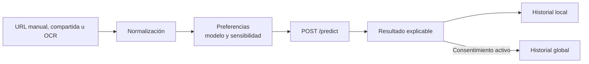

<div align="center">
  
  <h1>LinkShield AI · Aplicación Flutter</h1>
  <p><strong>Cliente multiplataforma para analizar URLs, interpretar resultados y administrar preferencias de detección.</strong></p>
  <p>
    
    
    
  </p>
</div>

---

## Descripción

Este módulo contiene la interfaz de LinkShield AI para Android y navegador. La aplicación permite ingresar o capturar una URL, seleccionar el modelo de inteligencia artificial, ajustar la sensibilidad operativa y consultar una explicación comprensible del resultado.

La misma base de código adapta la persistencia y ciertos flujos a cada plataforma: SQLite se utiliza en Android e IndexedDB en web.

## Funcionalidades

- Escaneo manual de URLs.
- Captura visual y extracción de enlaces mediante OCR.
- Recepción de enlaces compartidos desde otras aplicaciones.
- Selección entre 14 modelos registrados en la API.
- Perfiles de sensibilidad: agresivo, equilibrado y pasivo.
- Resultado con probabilidad, etiqueta, umbral, modelo y factores principales.
- Historial local persistente con filtros y detalle de explicabilidad.
- Historial global cuando el usuario habilita el almacenamiento en servidor.
- Dashboard de análisis y distribución de resultados.
- Vista técnica del modelo, métricas, datos y matriz de confusión.
- Temas claro y oscuro.
- Asistente Anita para consultas, análisis y explicación conversacional.
- Módulos educativos e interactivos de prevención.

## Pantallas principales

| Pantalla | Propósito |
|---|---|
| Inicio | Ingreso de URL, acceso a cámara y análisis principal |
| Captura visual | OCR, extracción y normalización del enlace detectado |
| Estadísticas | Actividad, proporción de riesgo y análisis recientes |
| Historial | Persistencia local, filtros y detalle explicable |
| Configuración | Modelo, sensibilidad, almacenamiento, tema y preferencias |
| Información del modelo | Métricas, dataset, matriz de confusión y variables |
| Anita | Interacción con el sistema multiagente y la base de conocimiento |

## Estructura

```text
lib/
├── database/    # Repositorios SQLite e IndexedDB
├── models/      # Entidades y contratos de datos
├── screens/     # Pantallas y navegación
├── services/    # API, preferencias, OCR y enlaces compartidos
├── theme/       # Estilos visuales
├── utils/       # Utilidades reutilizables
└── widgets/     # Componentes de interfaz
```

## Requisitos

- Flutter SDK.
- Dart `^3.5.3`.
- Chrome o Edge para desarrollo web.
- Android SDK y un dispositivo/emulador para Android.
- API de LinkShield AI en ejecución.

## Configuración

La URL del backend y la clave se inyectan durante la compilación mediante `dart-define`:

| Variable | Ejemplo local | Descripción |
|---|---|---|
| `API_BASE_URL` | `http://127.0.0.1:5000` | Dirección de la API Flask |
| `API_KEY` | `CLAVE_LOCAL` | Credencial compartida con el backend |

No agregues valores reales de producción al repositorio.

## Ejecución

### Preparar dependencias

```powershell
cd C:\phishing-url-classifier\phishing-url-app
flutter pub get
```

### Navegador

```powershell
flutter run -d chrome `
  --dart-define=API_BASE_URL=http://127.0.0.1:5000 `
  --dart-define=API_KEY=CLAVE_LOCAL
```

### Servidor web en la red local

```powershell
flutter run -d web-server --release `
  --web-hostname=0.0.0.0 --web-port=8005 `
  --dart-define=API_BASE_URL=http://IP_DEL_EQUIPO:5000 `
  --dart-define=API_KEY=CLAVE_LOCAL
```

### Android

```powershell
flutter devices
flutter run -d ID_DEL_DISPOSITIVO `
  --dart-define=API_BASE_URL=http://IP_DEL_EQUIPO:5000 `
  --dart-define=API_KEY=CLAVE_LOCAL
```

El dispositivo Android y el servidor deben poder comunicarse por la red. `127.0.0.1` dentro del teléfono apunta al propio teléfono, no al equipo que ejecuta Flask.

## Flujo de análisis



La sensibilidad modifica el umbral usado para asignar la etiqueta, pero conserva intacta la probabilidad calculada por el modelo.

## Persistencia y privacidad

- **Android:** SQLite mediante `sqflite`.
- **Web:** IndexedDB mediante `idb_shim`.
- **Servidor:** solo se utiliza cuando el usuario habilita almacenamiento global.
- Las preferencias de tema, modelo y sensibilidad se conservan con `shared_preferences`.

## Calidad

```powershell
flutter analyze
flutter test
```

La suite cubre, entre otros componentes, el repositorio web, las opciones de modelo, la información técnica y la extracción robusta de URLs mediante OCR.

## Compilación

```powershell
# Web
flutter build web --release `
  --dart-define=API_BASE_URL=https://api.ejemplo.cl `
  --dart-define=API_KEY=CLAVE_DE_DESARROLLO

# Android
flutter build apk --release `
  --dart-define=API_BASE_URL=https://api.ejemplo.cl `
  --dart-define=API_KEY=CLAVE_DE_DESARROLLO
```

> Una clave incluida en una compilación web no puede considerarse secreta. Para un despliegue público se debe usar autenticación real y un proxy de backend.

## Autor

**Alejandro Mayró Lena**

Consulta la [documentación general](../README.md) y la [documentación de la API](../phishing-url-api/README.md).

