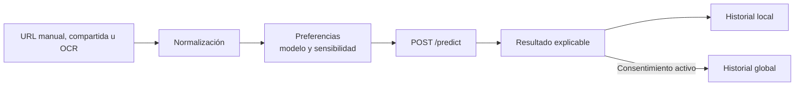

<div align="center">
  
  <h1>LinkShield AI · Aplicación Flutter</h1>
  <p><strong>Cliente multiplataforma para analizar URLs, interpretar resultados y administrar preferencias de detección.</strong></p>
  <p>
    
    
    
  </p>
</div>

---

## Descripción

Este módulo contiene la interfaz de LinkShield AI para Android, iOS y navegador. La aplicación permite ingresar o capturar una URL, seleccionar el modelo de inteligencia artificial, ajustar la sensibilidad operativa y consultar una explicación comprensible del resultado.

La misma base de código adapta la persistencia y ciertos flujos a cada plataforma: SQLite se utiliza en Android e iOS, e IndexedDB en web.

## Funcionalidades

- Escaneo manual de URLs.
- Captura visual y extracción de enlaces mediante OCR.
- Recepción de enlaces compartidos desde otras aplicaciones en Android. En iOS y web se puede pegar el enlace en el escáner.
- Selección entre 14 modelos registrados en la API.
- Perfiles de sensibilidad: agresivo, equilibrado y pasivo.
- Resultado con probabilidad, etiqueta, umbral, modelo y factores principales.
- Historial local persistente con filtros y detalle de explicabilidad.
- Historial global cuando el usuario habilita el almacenamiento en servidor.
- Dashboard de análisis y distribución de resultados.
- Vista técnica del modelo, métricas, datos y matriz de confusión.
- Temas claro y oscuro.
- Asistente Anita para consultas, análisis y explicación conversacional.
- Módulos educativos e interactivos de prevención.

## Pantallas principales

| Pantalla | Propósito |
|---|---|
| Inicio | Ingreso de URL, acceso a cámara y análisis principal |
| Captura visual | OCR, extracción y normalización del enlace detectado |
| Estadísticas | Actividad, proporción de riesgo y análisis recientes |
| Historial | Persistencia local, filtros y detalle explicable |
| Configuración | Modelo, sensibilidad, almacenamiento, tema y preferencias |
| Información del modelo | Métricas, dataset, matriz de confusión y variables |
| Anita | Interacción con el sistema multiagente y la base de conocimiento |

## Estructura

```text
lib/
├── database/    # Repositorios SQLite e IndexedDB
├── models/      # Entidades y contratos de datos
├── screens/     # Pantallas y navegación
├── services/    # API, preferencias, OCR y enlaces compartidos
├── theme/       # Estilos visuales
├── utils/       # Utilidades reutilizables
└── widgets/     # Componentes de interfaz
```

## Requisitos

- Flutter 3.38 o superior y Dart `^3.10.0`.
- Chrome o Edge para desarrollo web.
- Android SDK, JDK 17 y un dispositivo o emulador para Android.
- Xcode completo y CocoaPods para iOS. El objetivo mínimo del proyecto es iOS 15.0.
- API de LinkShield AI en ejecución.

## Configuración

La URL del backend y la clave se inyectan durante la compilación mediante `dart-define`:

| Variable | Ejemplo local | Descripción |
|---|---|---|
| `API_BASE_URL` | `http://127.0.0.1:5000` | Dirección de la API Flask |
| `API_KEY` | `CLAVE_LOCAL` | Credencial compartida con el backend |

Sin configuración se usa `http://127.0.0.1:5000` y no se incluye ninguna clave. No guardes claves reales en el repositorio ni uses una credencial de producción en una compilación distribuida.

## Ejecución

### Preparar dependencias

```powershell
cd C:\phishing-url-classifier\phishing-url-app
flutter pub get
```

### iOS

Con Xcode y CocoaPods configurados, abre un simulador o conecta un iPhone. Ejecuta desde este módulo:

```bash
flutter pub get
flutter devices
flutter run -d ID_IOS --dart-define-from-file=.vscode/api.local.json
```

El iPhone debe poder llegar a la API. Configura su dirección en `api.local.json` y usa un certificado HTTPS confiable para la distribución. En una prueba de red local, iOS solicita autorización para acceder al servidor. La cámara se prueba en un iPhone físico.

### Navegador

```powershell
flutter run -d chrome `
  --dart-define=API_BASE_URL=http://127.0.0.1:5000 `
  --dart-define=API_KEY=CLAVE_LOCAL
```

El escaneo visual permite seleccionar una imagen y ofrece captura en los navegadores móviles que la admiten. La lectura se ejecuta dentro del navegador. El primer uso carga el motor y el idioma OCR desde jsDelivr. El cliente usa la compilación JavaScript de Flutter Web.

### Servidor web en la red local

```powershell
flutter run -d web-server --release `
  --web-hostname=0.0.0.0 --web-port=8005 `
  --dart-define=API_BASE_URL=http://IP_DEL_EQUIPO:5000 `
  --dart-define=API_KEY=CLAVE_LOCAL
```

### Android

```powershell
flutter devices
flutter run -d ID_DEL_DISPOSITIVO `
  --dart-define=API_BASE_URL=http://IP_DEL_EQUIPO:5000 `
  --dart-define=API_KEY=CLAVE_LOCAL
```

El dispositivo Android y el servidor deben poder comunicarse por la red. `127.0.0.1` dentro del teléfono apunta al propio teléfono, no al equipo que ejecuta Flask.

Para generar un APK instalable de pruebas con la API local, utiliza el modo depuración:

```powershell
flutter build apk --debug `
  --dart-define=API_BASE_URL=http://IP_DEL_EQUIPO:5000 `
  --dart-define=API_KEY=CLAVE_LOCAL
```

HTTP se permite en Android solo en los modos `debug` y `profile`. Úsalos únicamente en una red de pruebas. El modo `release` requiere una URL HTTPS.

## Flujo de análisis



La sensibilidad modifica el umbral usado para asignar la etiqueta, pero conserva intacta la probabilidad calculada por el modelo.

## Persistencia y privacidad

- **Android:** SQLite mediante `sqflite`.
- **Web:** IndexedDB mediante `idb_shim`.
- **Servidor:** solo se utiliza cuando el usuario habilita almacenamiento global.
- Las preferencias de tema, modelo y sensibilidad se conservan con `shared_preferences`.

## Calidad

```powershell
flutter analyze
flutter test
```

La suite cubre, entre otros componentes, el repositorio web, las opciones de modelo, la información técnica y la extracción robusta de URLs mediante OCR.

## Compilación

```powershell
# Web
flutter build web --release `
  --dart-define=API_BASE_URL=https://api.ejemplo.cl `
  --dart-define=API_KEY=CLAVE_DE_DESARROLLO

# Android
flutter build apk --release `
  --dart-define=API_BASE_URL=https://api.ejemplo.cl `
  --dart-define=API_KEY=CLAVE_DE_DESARROLLO
```

> `dart-define` mantiene las claves fuera del código fuente, pero no las oculta dentro de un APK ni de una compilación web. Para un despliegue público se requiere autenticación de usuarios y mantener las credenciales de servicio en el backend.

## Autor

**Alejandro Mayró Lena**

Consulta la [documentación general](../README.md) y la [documentación de la API](../phishing-url-api/README.md).

